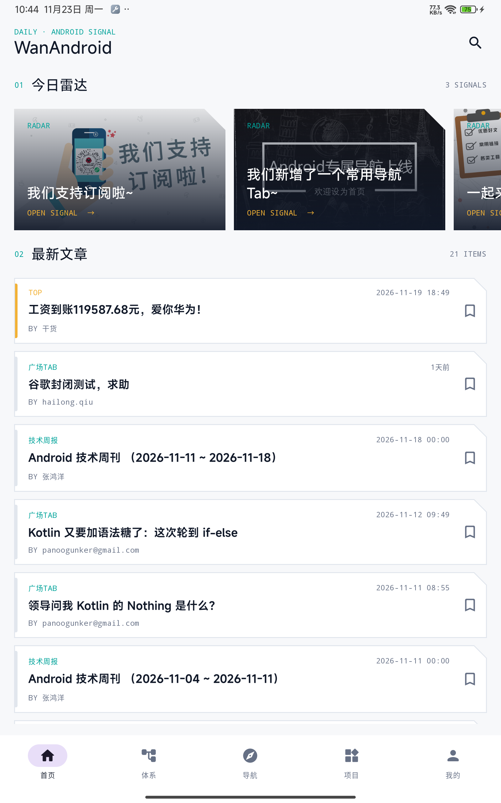
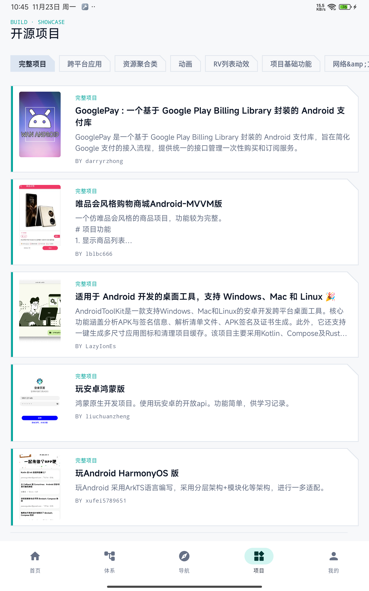
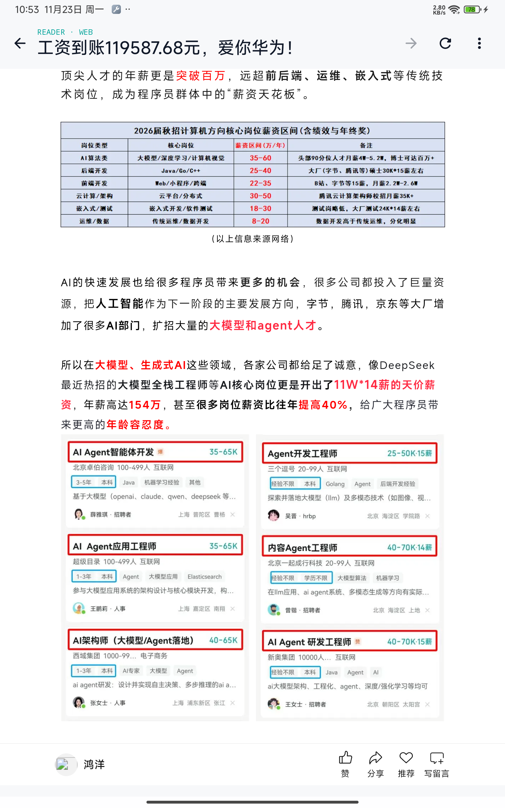
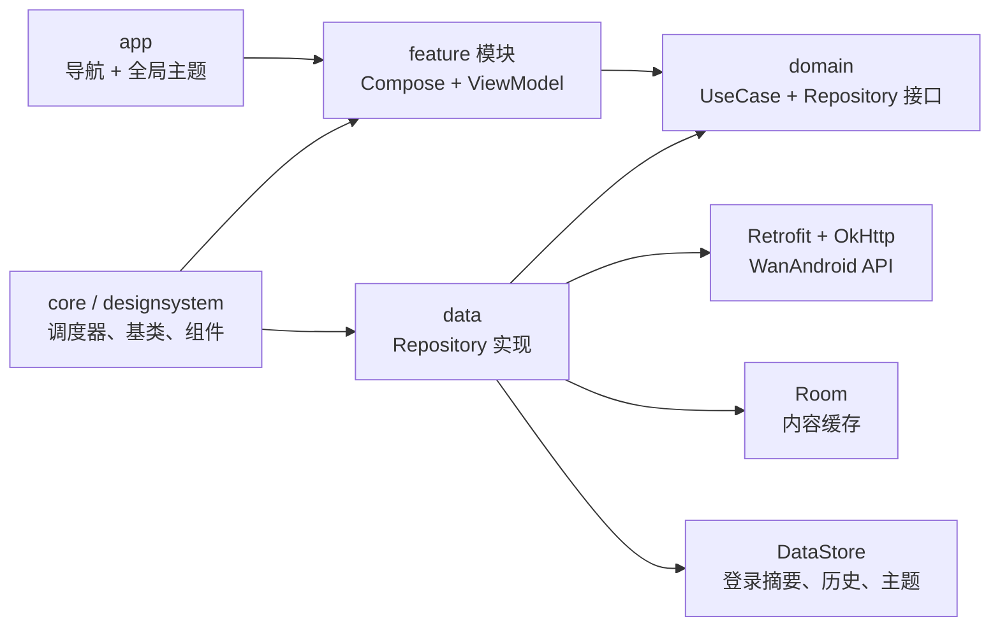

# WanAndroid

使用 Kotlin、Jetpack Compose 和分层多模块架构实现的 WanAndroid 原生客户端。

- 包名：`com.jacky.wanandroid`
- 最低版本：Android 7.0（API 24）
- 编译与目标版本：Android API 37
- 数据来源：[WanAndroid 开放 API](https://www.wanandroid.com/blog/show/2)
- API Base URL：`https://wanandroid.com/`

> 本项目是非官方学习型客户端，内容、账号和收藏数据均由 WanAndroid 服务端提供。

## 界面预览

| 首页与内容流 | 项目列表 | 安全阅读器 |
| --- | --- | --- |
|  |  |  |

界面采用 Material 3 与 Signal Desk 视觉体系，支持跟随系统、浅色和深色三种主题模式。主题偏好保存在本地，切换后整个 Compose 界面立即更新。

## 快速开始

### 环境要求

| 工具 | 要求 |
| --- | --- |
| JDK | 17 |
| Android SDK | API 37 |
| Gradle | 使用仓库内 Wrapper（9.6.1） |
| Android Studio | 支持 AGP 9.2.1 的版本 |

首次运行前，在项目根目录创建或更新 `local.properties`：

```properties
sdk.dir=C\:\\Android\\Sdk
```

Windows PowerShell：

```powershell
$env:JAVA_HOME='C:\Program Files\Java\jdk-17'
$env:ANDROID_HOME='C:\Android\Sdk'
.\gradlew.bat :app:assembleDebug
```

macOS 或 Linux：

```bash
export JAVA_HOME=/path/to/jdk-17
export ANDROID_HOME="$HOME/Android/Sdk"
./gradlew :app:assembleDebug
```

生成的 Debug APK 位于：

```text
app/build/outputs/apk/debug/app-debug.apk
```

也可以直接使用 Android Studio 打开项目，将 `app` 作为运行配置启动。

## 已实现功能

- 首页 Banner、置顶文章、分页加载、下拉刷新和收藏
- 知识体系一级/二级分类及分类文章列表
- 常用导航分类与文章入口
- 项目分类标签与分页项目列表
- 搜索热词、搜索历史、多关键词搜索和分页结果
- 登录、注册、退出登录和会话失效处理
- 收藏列表、收藏与取消收藏
- 个人资料、积分、等级和排名
- 跟随系统、浅色、深色主题设置与 DataStore 持久化
- Room 内容缓存和网络失败时的缓存回退
- 带进度、超时提示、错误页、刷新、前进/后退、复制链接和外部打开的应用内 WebView
- 拦截 `intent://` 等非 HTTP(S) Scheme，禁止网页自动拉起第三方应用

首版不包含 TODO、广场发布、问答评论、站内消息、Firebase、广告或应用内购买。

## 项目架构

项目采用 `app / core / domain / data / feature:*` 多模块结构。Feature 只依赖领域模型、仓库接口和用例，不直接访问 Retrofit、Room 或 DataStore。



### 模块职责

| 模块 | 职责 |
| --- | --- |
| `app` | Application、Activity、类型安全导航和全局主题状态 |
| `core` | 协程调度器、ViewModel 基类、通用结果与日志能力 |
| `core:designsystem` | Material 3 主题、颜色、排版和共享 Compose 组件 |
| `domain` | 领域模型、Repository 接口与业务用例 |
| `data` | Retrofit API、DTO 映射、Repository 实现、Room、DataStore 和 Cookie 会话 |
| `feature:home` | 首页、Banner、文章流与收藏入口 |
| `feature:knowledge` | 知识体系与分类文章 |
| `feature:navigation` | 导航分类与站点入口 |
| `feature:project` | 项目分类与项目列表 |
| `feature:search` | 热词、历史和搜索结果 |
| `feature:auth` | 登录与注册 |
| `feature:collection` | 收藏列表与取消收藏 |
| `feature:profile` | 个人中心、积分数据与主题设置 |
| `feature:web` | 安全 WebView 阅读器和加载状态 |

### 状态与数据流

- 页面使用不可变 `UiState` 描述可持续状态。
- Snackbar、导航等一次性行为通过 `Channel`/ `Flow` 发出。
- 所有业务用例返回 Kotlin `Result<T>`。
- 协程调度器通过 `DispatcherProvider` 注入，便于测试替换。
- 网络 DTO、Room Entity 和领域模型相互隔离，接口可空字段不会直接扩散到 UI。
- WanAndroid 响应仅在 `errorCode == 0` 时视为成功；`-1001` 会清理登录摘要并要求重新登录。

## 网络、缓存与会话

不同接口的分页起点由 Data 层封装：

- 首页、体系文章、搜索和收藏从第 `0` 页开始。
- 项目、积分等接口从第 `1` 页开始。
- 分页大小固定为 20，UI 无需处理服务端页码差异。

首页文章、Banner、体系、导航和项目分类等数据会写入 Room。请求失败时，Repository 尝试返回本地缓存并在领域分页对象中标记缓存来源。

登录 Cookie 使用 Android Keystore 中的 AES-GCM 密钥加密后保存到本地 `SharedPreferences`。应用不会保存用户明文密码；退出登录时会同时尝试退出服务端并清理本地 Cookie 和登录摘要。

## 主要技术栈

| 分类 | 技术 |
| --- | --- |
| UI | Jetpack Compose、Material 3、Navigation Compose |
| 状态管理 | ViewModel、Coroutines、Flow |
| 依赖注入 | Hilt |
| 网络 | Retrofit 3、OkHttp 5、Gson |
| 本地数据 | Room、DataStore Preferences、Android Keystore |
| 图片 | Coil 3 |
| 测试 | JUnit 4、MockK、Turbine、MockWebServer、Compose UI Test |

依赖版本统一维护在 [`gradle/libs.versions.toml`](gradle/libs.versions.toml)。

## 构建与测试

运行所有 JVM 单元测试：

```powershell
.\gradlew.bat test
```

执行所有 Debug Lint 检查：

```powershell
.\gradlew.bat lintDebug
```

构建 Debug APK：

```powershell
.\gradlew.bat :app:assembleDebug
```

连接设备或模拟器后运行个人中心 Compose 测试：

```powershell
.\gradlew.bat :feature:profile:connectedDebugAndroidTest
```

测试覆盖主题偏好映射、API 响应解包与分页起点、ViewModel 状态、WebView URL 策略，以及个人中心主题选择交互。

## 常见问题

### Gradle 找不到 Android SDK

确认 `local.properties` 中的 `sdk.dir` 指向有效 SDK，或设置 `ANDROID_HOME`。`local.properties` 包含本机路径，已由 `.gitignore` 排除。

### 文章长时间白屏

阅读器会立即展示加载状态；12 秒仍未显示内容时会提供继续等待、重新加载和外部浏览器入口。HTTP、SSL、渲染进程异常也会显示可恢复的错误页。

### 真机 Compose 测试一直等待

部分厂商系统会让 Compose 测试框架长时间等待空闲状态。请先解锁设备、关闭系统弹窗并保持屏幕常亮；CI 建议使用接近 AOSP 的 API 24+ 模拟器。

## 致谢

- [WanAndroid](https://www.wanandroid.com/) 提供开放 API 与内容服务。
- Android 与 Kotlin 开源生态提供本项目使用的基础组件。
